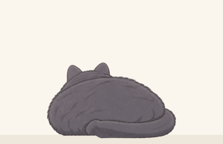

纪念我的达达（2015–2026）。

In memory of my Dada (2015–2026).

# Alongside

Alongside 让我的英短蓝猫达达以手绘动画的样子，继续陪在 Mac 桌面上。它喜欢背对着我趴在 Dock 上，偶尔回头看我一眼。

Alongside brings my British Shorthair, Dada, to life in hand-drawn animation on the Mac desktop. Dada likes to curl up on the Dock, facing away, and occasionally glance back at me.

