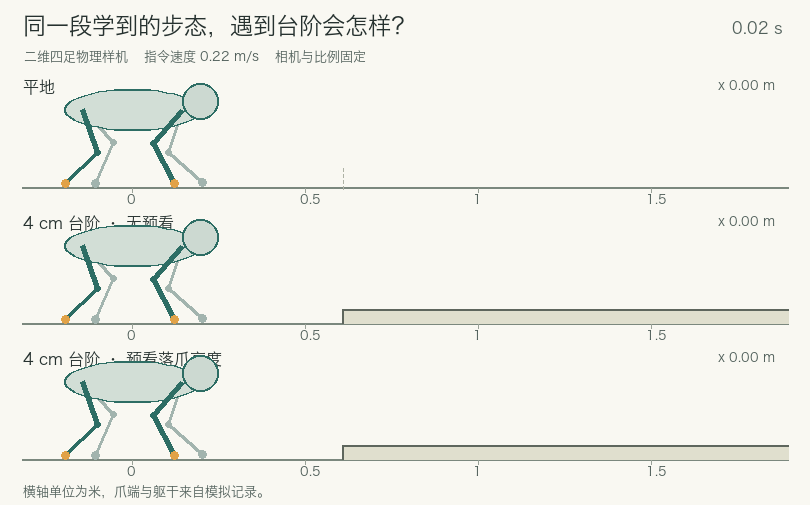

# 达达步态的二维物理实验

给达达一个能按任意相位迈步的身体，碰到 Dock 的台沿又会怎样？这里把旧骨骼的行走轨迹教给一个小网络，再让四足模型在重力、摩擦与关节力矩限制下走六秒。三条图共用相机、地形比例、速度指令和网络权重。图中轮廓对应碰撞几何，金色点标出近侧前后爪。



## 身体、训练和观测

- 身体沿桌面前后、上下移动，躯干可俯仰。前后各两条腿，每条由两段 13 厘米连杆和两个受控转轴组成。模型总质量 3.30 千克，腿长、质量和 0.8 秒周期是实验设定。平面限制排除了侧向失衡，腿之间省略了自碰撞，脊柱、腕跗关节和尾巴也被简化。
- 教师调用仓库旧骨骼的 [walking_targets](../../Rig/side.py)，取四爪相对各自支撑中心的水平和竖直位移。实验以每像素 1.3 毫米转换这份原画轨迹。网络输入为步态相位的正弦、余弦和速度，输出为四爪相对位移。96 个固定随机双曲正切单元提供非线性特征，以岭回归拟合 776 个输出层参数。训练使用 1,600 组随机相位和速度，速度范围为 0.12–0.30 米/秒。
- 各控制器均使用逆运动学，将爪端目标转换为八个关节的目标角，每秒更新 50 次。位置伺服器每关节最多输出 ±4 牛顿米，MuJoCo 每秒推演 500 次。躯干的前进、升降与俯仰由动力学算出。
- 地形辅助使用模拟环境的精确高度。每只爪离地时，根据相位、水平位置和速度指令预测落点，查询落点前缘的高度，提前抬爪并依据四爪所处的台面修正相对躯干的腿长。它是手写的身体控制，同一网络可打开或关闭它。[MuJoCo 模型与接触参数](https://mujoco.readthedocs.io/en/3.3.7/XMLreference.html)

## 结果

固定训练种子 141。400 组另取的同分布样本，每组四只爪，网络对教师的爪端目标平均平面误差为 **0.15 毫米**。它衡量网络复现程序曲线的精度，真实运动表现另由下表检验。

每格含 12 次确定性运行，覆盖 0.16、0.22、0.28 米/秒和四个不同起步相位。自起点 0.61 米处设置台阶，平地在同一位置设置虚拟通过线。通过要求六秒时前后腿根均越过该线，且没有采样到头或躯干与地形接触。表内依次为通过次数和躯干平均水平位移。

| 地形 | 程序教师 | 网络 | 网络加落点高度 |
| --- | --- | --- | --- |
| 平地，摩擦系数 0.9 | 12/12，1.359 m | 12/12，1.363 m | 12/12，1.363 m |
| 平地，摩擦系数 0.12 | 12/12，1.355 m | 12/12，1.351 m | 12/12，1.351 m |
| 上 4 cm 台阶 | 0/12，0.422 m | 0/12，0.421 m | 12/12，1.350 m |
| 上 8 cm 台阶 | 0/12，0.422 m | 0/12，0.421 m | 10/12，1.215 m |

平地降摩擦后，网络仍能走过标记，但受力爪的平均切向滑速从 **20.63 升到 45.38 毫米/秒**。这个量每秒采样 50 次，统计法向力至少 1 牛顿时爪上接触点相对于静止地面的切向速度大小，先在每次运行内部取均值，再平均 12 次。只看躯干走了多远，会漏掉打滑。8 厘米台阶的两次失败都发生在 0.22 米/秒，躯干中心已到达 0.637、0.638 米处，后腿仍未越线。

在这些设定下，步态即使模仿得很准，正前方的台阶仍会把达达挡住。加入一个可以直接由桌面地形提供的落点高度，就改变了结果。试验只覆盖单级直角上台、无噪声高度查询和一个训练种子。它还不能回答下台阶、恢复平衡、步态外观或与真实猫的相似度。下一种更难且可检验的情形是改变台阶位置，并叠加落点估计误差，看是否需要根据实际爪触地时机重新迈步。

## 用一只真猫的步态驱动同一个身体

Rahmati 等发表的补件 4 提供了一只 3.2 千克母猫在平地上行走的标记轨迹。相机以 120 Hz 记录。实验提取了四爪前后和竖直两个方向，水平方向减去同侧肩或髋的位置及训练周期的平均偏移，竖直方向减去各爪训练周期高度的第 5 百分位，用爪尖标记近似落爪位置。[原论文与 Supplement 4](https://pmc.ncbi.nlm.nih.gov/articles/PMC11737544/)

取左前爪连续三次摆动高点作边界，得到相邻的两个完整周期。第一个周期 88 帧、0.733 秒，双髋中心前进 0.450 米。只用这 88 帧拟合同型网络，速度输入恒定，将四爪相对位置建模为相位的函数。训练周期的四爪平均平面误差 **0.09 毫米**。第二个周期的 83 帧全部留出，按它自身的周期归一化相位，误差增至 **5.71 毫米**。这是同一只猫在同一段记录中下一步的预测，对陌生猫和其他速度的表现尚无检验。

另在本实验的平地上执行这组学到的目标，每种映射使用四个起步相位，每次六秒，模拟周期都固定在 0.8 秒。用原记录的水平摆幅驱动简化身体时，它平均走 **0.511 米/秒**，承重爪滑速 **44.31 毫米/秒**。根据指令速度 0.22 米/秒，将水平摆幅乘以 0.22 × 0.8 / 0.450 ≈ 0.391，保留抬爪高度，模拟速度变成 **0.200 米/秒**，滑速 **15.61 毫米/秒**。两组都没有采样到头或躯干触地。这里测试了把一条实测轨迹迁移到慢速桌面身体，前面的台阶实验仍独立使用程序教师。

## 本地复现

在本机 Apple Silicon CPU 上，一次完整运行（拟合、评估，以及 144 次各六秒的模拟）耗时 4.51 秒，不含安装依赖与编码动图。这是简化物理模型的耗时，长视频提取、强化学习与完整角色渲染均需另行测量。

从项目根目录执行。复现时使用了 Python 3.13.2 和以下版本。

```sh
python3 -m venv /tmp/alongside-gait
/tmp/alongside-gait/bin/python -m pip install mujoco==3.3.7 numpy==2.3.1 scipy==1.16.0 pillow==11.3.0
/tmp/alongside-gait/bin/python -B Tools/Research/CatBody/gait.py
```

加上 `--gif /tmp/alongside-gait.gif` 会导出三条实测轨迹的动图。用 `--seed 142` 可更换训练和留出样本的随机种子，速度、地形和起步相位组合仍相同。

复现真猫对照时，从原论文的 Supplement 4 下载 `TJP-603-447-s001.xlsx`，将文件路径作为唯一参数传入。下列命令在内存中读取这张表、拟合网络并打印摘要。仓库仅保存读取程序与汇总指标。发布训练权重或分发原轨迹前需核对补件授权。

```sh
/tmp/alongside-gait/bin/python -B Tools/Research/CatBody/retarget.py /path/to/TJP-603-447-s001.xlsx
```
