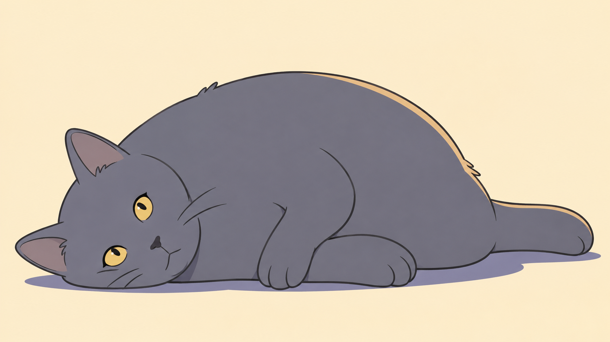
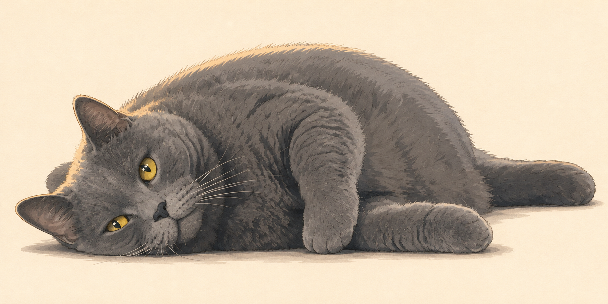

# 达达

Alongside 的第一位桌面伙伴。主人描述达达是一只 11 岁半、约 9–10 公斤的英短蓝猫，平时更喜欢躺着。

## 动画 · 从坐着到趴下

[播放预览](animations/sit-to-rest-v1/dada-sit-to-rest-preview.gif) · [透明逐帧图集](animations/sit-to-rest-v1/dada-sit-to-rest.png) · [帧坐标和播放时长](animations/sit-to-rest-v1/dada-sit-to-rest.json)

这段过渡由九张姿势稿组成，共 1.22 秒。造型以第三版正脸为主，第六版用于参考躯干和毛色。达达先向前探爪，随后屈肘落胸，最后腹部贴地，仍抬着头看人。

图集每格 420 × 420 像素，按从左到右、从上到下的顺序排列。各帧已按同一地面位置对齐。按 JSON 中的毫秒数播放一次，停在第九帧进入趴卧状态。GIF 为方便比较，在起点和终点额外停留并循环。

动画姿势稿绘图提示（内置图像生成）

Make a PRODUCTION ANIMATION SPRITE SHEET, exactly 3 columns and 3 rows on an evenly spaced invisible grid, nine different successive full-body drawings of ONE specific cat. Nine cells read left to right row by row; every cell contains precisely one separate cat. Transparent alpha background, no cast shadows, no floor, no text, no numbers, no grid lines, no captions. Leave clear transparent gutters both horizontal and vertical. Square sheet. This is HAND-DRAWN FRAME BY FRAME ANIMATION for a desktop game: one continuous movement, an adult heavy British blue shorthair cat Dada slowly lowering himself from sitting to RESTING ON HIS BELLY, not rolling to the side. IMPORTANT artist's model: first attached image is the owner-approved FACE model. Copy that moderate cheek width, slightly tapered muzzle, small lower chin, black triangular nose, real adult head and ear proportions and curious GOLD eyes looking at the camera in all 9 drawings. Second is the owner's cel illustration guide for the flatter body, cool blue-grey coat and intermediate sparse fur strokes. Third photo shows his sitting posture. The rectangular screen space of each cell and the art scale are identical. Head is same absolute width every single frame; no zoom. Every frame has the same camera: low eye-level from slightly to cat's front-left, FACE NEARLY FULL FRONT to preserve his likeness, rump projects slightly to screen right. His facing angle, eyeline, orientation of body and camera stay the same. Buttocks planted at screen-right throughout, tail lies in a loose curl at his right flank and stays still. Paws, all legs, ears and tail fully inside the cell. Same ground baseline every cell. Each pose must be visibly successive, not separate cute actions. Read across rows. 1: sitting completely upright, two straight forelegs, chest high, paws close below shoulders. 2: still tall, slight forward lean, first paw unweights. 3: one forepaw reaches just forward. 4: both forepaws now reach ahead, shoulders bending, rear haunch grounded. 5: both elbows bending more, sternum halfway down, back inclining lower. 6: elbows further bent, front legs foreshortened lying forward, chest now just above the paws. 7: chest meets ground, rear legs already tucked, belly comes to rest; shoulders lower. 8: fully prone on sternum with both forepaws gently ahead, head still up but a little lower, facing the camera, calm. 9: almost exactly same pose as 8, weight settles into forearms, eye gaze softens; compact flat belly-down resting cat, head up and recognizable. Weight gradually shifts and settles, biggest motion in middle. Do not draw a standing cat at any stage. Style is natural warm classic Japanese hand-inked 2D animated film cel, expressive economy of line, 2-3 flat cool blue-grey tones, modest muted gold eyes, sparse short tufts, adult believable proportions. Important no lighting variation between cels, no glossy fur or 3D, never a generic big round kitten. Clear consistent drawing at small scale. Treat as one continuous action with nine different frames, not nine cats in one scene.

## 第六版 · 侧躺时的背线

[第六版侧躺稿](resting-v6.png) 以主人更喜欢的[第四版](resting-v4.png)为底稿。头部沿用第四版的比例，肩后到臀部的背线压低，腹部贴地，侧躺时身体更扁。

第六版绘图提示（内置图像生成）

Precise local edit of the attached illustration, which is Dada resting version FOUR. Return the complete matching landscape illustration at identical framing and scale. The owner likes this version, in particular its face and head size. CHANGE ONLY THE TORSO SHAPE: make his side-lying body look a little flatter and less fat, as a relaxed mature cat settled under its own weight. Take about 12–15 percent off the existing vertical thickness of the ribcage, flank and haunch (floor-to-back measurement; lower the highest point of his back by about 75-85 pixels in this source frame of height 941). Keep the belly's contact with the floor exactly where it is, the far-right hind paw tip where it is, same natural horizontal length. Lower the back gently from immediately behind the shoulder to the rump, changing the very tall dome into a lower, more leisurely arc. Still clearly a comfortably plump adult British blue cat. This is a silhouette revision only: match the original head region exactly in SIZE, outline, angle, location, both eyes, whiskers, ears, muzzle, nose, facial expression and drawing. Preserve shape, size and position of the near foreleg and paw. Preserve all of the original's simplicity, blue-grey cel colors, sparse grouped fur strokes, warm cream background and soft warm rim on the back. No camera change or reframing. Do not apply a global vertical squash to head or entire image. Output one cat, no text, no comparison panels.

## 第五版 · 侧躺时的头身比例

[第五版侧躺稿](resting-v5.png) 对照了床上蜷卧的 `5.jpeg`、正面坐姿 `8.jpeg` 和桌面侧躺的 `7.JPG`。这次把头连同耳朵和五官一起略微缩小，让颈侧露出更多厚实的肩膀。脸型继续参考[正脸稿](face-front-v3.png)。

第五版绘图提示（内置图像生成）

Make a tightly controlled revision of the first attached drawing, resting-v4.png. Deliver one full-canvas wide illustration matching it. The owner finds the head still a little too large on this individual cat, Dada. Make a clearly visible but modest reduction in the actual size of the entire head (both ears, forehead, eyes, nose, jaw and whiskers as one coherent unit), by about one tenth in BOTH linear dimensions versus the first drawing, on the IDENTICALLY sized body. Anchor the cheek contact on the same ground line, bring the head in a little closer to the forechest as it gets smaller. As a result the ears sit visibly a little lower, a little more of the thick shoulder shows behind the head, the volume around the back of the jaw belongs to the neck instead of the cheeks. Head must not look merely squeezed; scale all facial landmarks together. Keep the approved frontal portrait in attachment 2 as the facial identity: chin is small, muzzle subtly tapered, rounded golden yellow eyes, upright triangular ears with soft tips, small dark nose. Attachment 3 (curled on bed, 5.jpeg) and attachment 4 (sitting front view, 8.jpeg) show Dada's relatively compact head in front of his very broad trunk; attachment 5 (lying on desk, 7.JPG) shows cheek resting low against the desk with head tilted on its side. Draw the SAME resting pose as in the first drawing, just a little more naturally nestled into the neck. Keep the prior illustration's chest, back arch, belly, paws, pose, outlines, golden eyes, blue-grey design, sparse clusters of short fur marks, warm cream paper, contact shadow and wide framing. Keep clean warm hand drawn Japanese 2D animation cel character design. Frame as the previous image; do not zoom or scale down the whole cat. One entire reclining cat only; no inset, text, objects, decorations or border.

## 第四版 · 侧躺

[侧躺修订稿](resting-v4.png) 参照主人觉得更像达达的[正脸稿](face-front-v3.png)，收小侧躺时头部相对身子的比例，让两颊在嘴角处向小下巴收拢。肩背、颈侧和前腿用疏落的小簇笔触表现蓝灰短毛。

第四版绘图提示（内置图像生成）

Revise image 1 (the SIDE-LYING animation drawing). Output ONE complete horizontal side-lying cat drawing only. Image 2 is the OWNER-APPROVED FACE LIKENESS, the front portrait of Dada. Image 3 is the real cat lying down as a reference for how its cheek rests on the surface. Preserve image 1's framing, slate-blue coloring, warm pale background, heavy adult body curled on its side, four-paw anatomy and peaceful gold-eyed gaze. Use exactly this natural hand-drawn Japanese animated film character style, with graceful expressive outlines and clean cel colors.

Principal visible correction: in image 1 the lower face is a wide jowly disk. REDRAW the outer silhouette, not just the mouth line: make the entire head look a little smaller compared with the unchanged big body, keep forehead width and ear spacing near original, pull BOTH lower cheek silhouettes inward from just below the eyes so that face tapers gently but clearly to the projecting nose and petite chin of image 2. Remove the large flared jowl between the mouth corner and neck on the upper side of the tilted head: show a small inward curve under the jaw before the thicker neck. On the floor side keep a slight compression where cheek touches ground, only a little flat contact area. Keep the whisker pads small, smoothly rounding into a subtle short tapered muzzle, recognizably feline (not a sharp fox snout or paper triangle). Preserve nose bridge length and charcoal triangular nose, convincing warm yellow eyes and adult proportions as in image 2.

Second visible correction: medium-sparse, purposeful graphic fur detail across face AND body. Image 1 has large blank shapes while image 2 has dense strokes. Choose a visibly intermediate level. Suggest dense short fur with a handful of spaced clusters of short tonal pencil marks: at cheek/ear base, in the fold of the neck, over the far shoulder, a couple of small clusters along the upper flank and round haunch, at bends of the near foreleg and paw. Use subtle blue-grey marks a shade away from the local fur. Preserve generous smooth passages on belly and back, no repetitive hatch all over, no stripes and no realistic individual hair rendering. Same confident, warm 2D cel-animation feel throughout, with a slight organic softness in the pencil outlines. Wide portrait with room around ears, rump and feet. No text, objects, inset portrait, other cats, or accessories.

## 第三版 · 脸型校准

[正脸对照稿](face-front-v3.png) 以主人的 `8.jpeg` 为主，配合 `1.jpeg` 校准眼距、鼻梁与嘴边的轮廓。[侧躺修订稿](resting-v3.png) 把这些特征放回桌面姿势。两张均为待主人比对的设计稿。

第三版绘图提示（内置图像生成）

Edit the FIRST image, a flat blue-grey cat animation cel, to restore the EXACT facial likeness of a specific real cat, Dada. IMAGES 2 and 3 are the identity references 1.jpeg and 8.jpeg; IMAGE 4 is the exact sideways angle and expression 7.JPG. Retain the current simplified hand-drawn Studio Ghibli 2D animation style, side-lying body, resting forepaw, warm ivory backdrop, golden eye color and cool slate fur. CHANGE THE FACE SHAPE substantially: the present geometric disk with miniature button features is the problem. Look at the real top of the skull, cheek, muzzle and jaw silhouette in the photos as if rotating a careful front-view drawing to the lying angle. His forehead is moderately broad and quite flat between clearly separated upright triangular ears with softly rounded tips. His face is widest just below his eyes; the lower cheeks taper gradually INTO A SMALLER, SLIGHTLY PROJECTING MUZZLE AND A SHORT, VISIBLE CHIN. The jaw is NOT a broad continuous oval curve under a mouth mark. Explicitly sculpt the silhouette around the two small rounded whisker pads and the receding chin below them: you can see the break between muzzle and lower cheek even at small size. Nose bridge has an actual length with a very subtle single second tone under the near eye; nose is a wider soft triangular charcoal pad instead of a tiny button. Keep distinct short philtrum and the short softly downturned paired mouth corners of the photos. In the reclining pose resting cheek gently flattened. Eyes naturally spaced relative to nose, soft almond-round, generous golden irises, lower eye partly closed, upper eye attentive, NOT small widely-diverging bean shapes. Few fine pale whiskers emerging from whisker pads, not 3 short dark stripes on cheeks. Soft serious calm expression. Keep adult proportions and 9-10kg body. This is an animator's drawing of one identifiable pet: elegant organic pencil contour, a few economical thin interior lines and flat restrained cel shadow just beneath muzzle, jaw and neck to define the facial structure, rare grouped little tufts, never photographic fur texture or densely modeled realism. Warm domestic traditional Japanese animated feature cel feeling. FULL BLEED ONE panel, one cat only, same full-body composition with ample edge margin, no close-up insets, no notes or text. Prioritize likeness of widest cheek and narrower muzzle visible in original photos.

A single clean front-facing head-and-shoulders identity drawing of Dada for a Studio Ghibli animated film, in traditional Japanese 2D hand-painted cel style. Use the first photo (8.jpeg, the frontal seated portrait) as the exact drafting template for facial proportions and attitude: identical upright head orientation, identical direct curious gaze and interocular distance. Second photo confirms character identity, fur color and muzzle. Draw Dada recognizably. Carefully observe the smallish head on a thick neck and broad shoulders of an older very heavy British blue cat. Silhouette widest just below eyes, cheeks moderately full, lower face tapers in to a small chin and slight forward pointed muzzle. Moderately high well separated ears, a flat span of forehead, clear gold-yellow irises with natural pupils, eyes set apart but normal adult cat size. Preserve the visible distance from eyes to nose and the shape of the small dark triangle at the end. Whisker pads subtly rounded, delicate pale whiskers sweeping out. Ears, head and top of shoulders visible; use the same centered composition as the first photo, crop at upper chest. Distinctly animation cel: draw as if a senior key animator just finished a clean-up drawing. Very few fine, warm, variable-weight ink strokes, matte blue-grey local color, one restrained slate shadow plane under the cheek and along the neck, sparse whiskers, attentive unsmiling mouth, understated. The subtle asymmetry and individual bone structure of the real cat should survive simplification. Warm light neutral paper background. No photorealistic fur description in the painting, no etched texturing, no digital airbrush gradients, no massive jowls, no large round mascot head, no humanlike eyebrows, no collar, no furniture, no words. One single finished character portrait.

## 第二版 · 手绘动画

以 `7.JPG` 的侧躺姿势和 `1.jpeg` 的五官为依据，用蓝灰色块、大弧线和简洁的金色眼形表现达达。背上只留一线暖光，脸颊贴着地面。此稿供确认动画风格。

第二版绘图提示（内置图像生成）

Redraw Dada as a 2D animated ACTING CHARACTER from a warm, classic Studio Ghibli film. Radical simplification: this should look unmistakably like one clean, hand-inked and flat-painted cel that an animator could redraw 24 times, not an illustration of a real animal. FIRST image ONLY describes the pose and individual. SECOND image is Dada's facial identity. Compose an isolated full-body cat lying sideways, horizontal, with an understated pale butter paper backdrop and tiny soft flat contact shadow. The pose in photo 7: torso to the right, on the left one cheek squashed flat to the surface, head tilted nearly 70 degrees, looking out at us, the bottom eyelid squeezes a little, near forepaw flops across the other. Show the big soft belly, broadly curved back, one back leg peeking out behind. Simplify the body into one generously long low rounded blue-grey shape and head into a handful of lyrical, imperfect dark graphite colored ink lines. Keep his adult proportions, relatively modest head, distinct upright ears with rounded tips, slightly forward tapered muzzle, a little downturned mouth and a soft chin, very small dark nose. His golden yellow eyes have simple plainly drawn pupils, feline proportions and the tender, faintly questioning gaze of someone following their person from the comfort of the floor. Eyes lively through silhouette, never through realistic rendering. Two whiskers each side. Dominant solid grey-blue local color plus ONE clean, gently curved blue-violet cell-shadow shape under body, warm reflected light only as a restrained accent. Each shape is matte flat fill. Short velvety coat suggested simply by silhouette; at most three tiny contour tufts in the entire drawing. ABSOLUTELY NO fur strokes, hatching, nose detailing, realistic anatomy rendering, brushy gradients, mottled or textured body rendering, glossy 3D, traced photo detail or decorative ornaments. No oversized baby face. Think a paused cel from a quiet domestic scene in Kiki's Delivery Service or My Neighbor Totoro: expressive timing, sparse contours, bold simple shapes. Cat occupies most of the wide composition, no objects, borders or lettering.

## 第一张角色稿

第一版依据 `7.JPG` 画侧躺。保留头贴桌面时两眼一高一低的角度、搭在胸前的前爪，以及从肩背延伸到后腿的轮廓。这是供主人比对的初稿。

## 画达达时的观察

- 胸腹和后胯宽厚，坐起来身体比头宽得多。脸颊有肉，往嘴边轻轻收窄，小下巴仍然看得见。
- 耳朵直立，耳尖略圆。鼻头深灰，胡须细长。双眼以金黄为主，角色设色参照多张照片中的共同特征。
- 毛短而密。不同光线下，从窗边的银灰到背光处的炭灰都有。肩颈和腿上的深浅随毛流和姿势变化。
- 桌面动作可以从静卧开始，只让眼睛转过来或耳朵轻动。照片里还记录了翻肚仰躺、两只前爪松松弯在胸前的姿态，可作另一种休息动作的依据。

造型参考了主人提供的八张照片。 `1.jpeg` 和 `8.jpeg` 看正脸与坐姿，`2.jpeg` 看背影，`3.jpeg` 和 `4.jpeg` 看眼睑与嘴边轮廓，`5.jpeg` 看卧姿与尾巴，`6.jpeg` 看仰躺，`7.JPG` 看桌面侧躺。

第一版绘图提示（内置图像生成）

请用内置绘图为 Alongside 绘制第一张达达的手绘动画角色原画。横幅，一只猫单独的全身侧躺姿势，是真实个体的动画化。第一张照片 7.JPG 是姿势和构图的直接依据：头在左边，重量压在一侧脸颊上，颈部放松，身子向右延伸，近侧前腿弯下来绕在胸前，另一爪自然放着，后腿沿地面伸向右方，金黄色双眼从这个歪着头的角度安静看人。保留这张照片里真实的头身比例、身体的大圆弧和四肢的自然遮挡，画全耳尖和爪尖，给四周留少量呼吸空间。照片 1.jpeg、8.jpeg 是五官比例依据，5.jpeg 是体量与冷蓝灰毛色依据。达达是一只 11 岁半、约 9–10 公斤的英短蓝猫，胸腹很厚，侧卧时身体沉沉地摊开，头相对身子小。两只立耳间距清楚，耳尖柔圆。脸颊有肉，嘴边往前微微收尖，下巴小，短鼻梁有长度，深石墨灰小三角鼻，两侧胡须垫细致，几根长而浅色的胡须。适度收敛的金黄眼睛略带橄榄色调，黑色瞳孔，自然眼球大小。短而密实的纯蓝灰毛。风格为温暖自然的吉卜力式日常二维手绘赛璐璐动画原画，有生命力的细铅笔线，凝练的大块两三层明暗，局部轻微干笔，体积和重力准确，缩小时面部依然清楚。以耳缘和背脊上一缕柔和暖光显出午后的气息。背景仅淡米白原画纸及与腹部相接的一小层淡淡投影。只有一个全身侧躺的达达，忠实肖像，成年比例，无文字、家具、配饰、花纹、白胸、夸张发腮、幼猫大眼或拟人表情。

