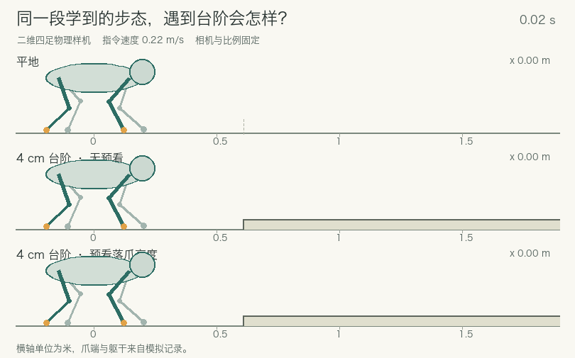

# 达达能从真猫和主人身上分别学什么？

## 0.1.18 新增的两种实际控制

自然理毛可以短到只洗一处，也可以在几处之间换着洗。达达用同一轮最近的部位选择下一组目标，用另一批真猫的逐秒记录估计何时收势。训练采用 40 场记录中可映射到现有绘稿的 39 场。网络学习的是同一场里各部位所占时间的关联，具体的先后顺序由桌面版本生成。按猫留出验证时，使用近期部位的网络与平滑共现表表现接近，都优于一直使用固定比例。菜单“洗洗脸”保留完整展示，适合观察新版头颈和后爪怎样合作。[理毛对照](media/dada-grooming-comparison.gif) · [训练与数据来源](../Tools/Research/Grooming/README.md)

正面趴姿多了半眨、眯住和闭眼再睁开。用 18 只猫在表情中性与慢眨眼两种实验条件下的成对记录拟合发生率。指针安静靠近时，沿用达达自己的注意和偏好模型；它决定看时，眼部模型有机会叠加动作。菜单“对达达慢眨眼”会给它一次明确的社交信号。实际桌面交互和等待窗口是本版设计，原始表格记录的是每分钟的次数和总时长。[眼神模型与复训](../Tools/Research/EyeResponses/README.md)

## 0.1.17 的桌面实验

2026 年 11 月 23 日的本机研究。0.1.17 把“愿不愿意跟人走几步”接入桌面达达。它正面趴着时，指针在脸旁停约半秒，沿同一侧缓缓移开一两个身长，再停一下。它可能起身跟过来，走完重新趴下，接着休息。[近处、远处和台沿的实际回放](media/dada-invitation.gif) · [可复现实验](../Tools/Research/)

菜单“趴一会儿”可以进入正面趴姿。从远处把指针移近它的脸，它会选择休息或把眼睛和耳尖转过来。在“互动习惯”里可分别教它靠近时多看或多歇、招手时跟来或留下。清醒趴姿下完成温和的头背双击会积累熟悉度，半小时最多计入一次。熟悉度略微延长温和注视，也会提高它平静时接受邀请的概率。原始鼠标轨迹只用于当下计算。本机分别保存显式偏好计数、熟悉度和上次计入的时间。[桌面注视预览](media/dada-attention.gif)

招手的小网络用 8,192 次合成桌面邀请训练。它读取脸旁停留时间、指针移开速度、卧姿的休息倾向和近期打扰程度，给出愿意跟随的概率。以同一次平静邀请为例，在空白招手偏好下，记住 12 次温和互动时的概率由 69.3% 增至 77.2%。这是本版设定的熟悉度影响，真实家庭互动数据有待采集。每次跟步预先计算起身、迈步和收势所需空间，距离改变步数和步频，每一步的长度取自原画的承重爪。台沿、路过或按住鼠标拖动均有回放对照。关节力矩控制继续在下文的 MuJoCo 样机中验证。[邀请训练与复现](../Tools/Research/CatPolicy/README.md) · [落爪与步频](../Sources/ApproachGait.swift)

真实家猫网络只参与原有作息允许的清醒选择，剔除当前姿态和没有绘稿的动作后采样。逐秒卧姿记录同时提供未来半分钟仍趴着的概率，作为注意模型的休息倾向输入。睡眠时长继续采用达达的角色设定。指针回应的训练标签来自合成桌面互动。基础模型随应用打包，日常使用只更新本机档案。要换用重新训练的权重，可按[真实行为实验](../Tools/Research/ObservedBehavior/README.md)重新导出，再构建应用。

**这版的行走仍有一个看得见的限制。** 有时达达会离指针稍远就趴下，因为剩余距离已容不下一圈能接回卧姿的步子。侧面骨架的下一项实验可以让最后一步缩短，比较它能否停得更准，同时让支撑爪在地上站稳。达达的金眼睛、略收尖的嘴边和低卧姿势仍有原画作为校对依据。[达达的造型笔记](../art/characters/dada/design-notes.md)

## 四个本机实验

### 1. 一只真猫结束理毛之后，会做什么？

用 Smit 等人的录像人工标注训练了一个 141 参数的小网络。纳入的五类动作为卧、坐、站、行走或小跑、自我理毛。猫走出画面、标注重叠、出现其他行为或时间不连续时，重新开始一段记录。保留了 12 只猫的 115,838 个可用观测秒，得到 1,349 个有前序动作、已知当前持续时间和可见下一动作的切换。每轮留出整只猫，最后对 12 只猫等权求平均。[数据与下载](https://doi.org/10.6084/m9.figshare.23605842.v2) · [采集与标注方法](https://pmc.ncbi.nlm.nih.gov/articles/PMC10458840/) · [训练与推断](../Tools/Research/ObservedBehavior/README.md)

| 已知要切换，预测下一类 | 命中率 | 负对数似然，越低越好 |
| --- | ---: | ---: |
| 只看各类出现频率 | 51.84% | 1.250 |
| 只看当前动作的转移表 | 82.66% | 0.604 |
| 考虑前一动作、当前动作和时长的计数表 | 84.88% | 0.496 |
| 使用相同信息的小网络 | 84.82% | 0.465 |

这批切换有约 82% 会回到前一类。记住“开始理毛前在做什么”就很有用。网络给实际发生的动作分配了更合适的概率，首选动作的命中率与计数表相当。用所有样本训练后，输入“上一段卧、这段理毛 15 秒、此刻结束”，下一类预测为卧 72.1%、坐 21.3%。这里的 72.1% **只在理毛已经结束的条件下成立**。模型没有测到达达想理毛的动机。观察集中在有工作人员和喂食的白天。公开表中明确标为睡眠和人类接触的观测秒均为零。[标注定义与观察时段](https://pmc.ncbi.nlm.nih.gov/articles/PMC10458840/)

为了让它自己动起来，又用 69,993 对前后可见的相邻秒估计“已经坐了这么久，下一秒会不会结束”。观察被截断的最后一秒不算退出。这个时长模型和小网络合起来，能在本机生成连续行为。固定种子的两分钟是 **坐 12 秒 → 理毛 39 秒 → 坐 15 秒 → 理毛 6 秒 → 坐 2 秒 → 理毛 33 秒 → 坐 3 秒 → 理毛 10 秒，观察结束**。用同一批数据重新训练和回放，得到了相同权重与轨迹。它学到了局部衔接。要决定一天理几次毛、一次之后隔多久，还应对长时段回放及家庭活动预算做检验。[模拟与复现](../Tools/Research/ObservedBehavior/README.md)

### 2. 一只猫上一季的习惯，能帮助预测下一季吗？

另取 Smit 发布的 15 KB 家庭猫周汇总表。28 只猫来自 23 户，每只各有夏冬一周的八类活动占比，来自项圈分类器。对每户整户留出，用其余家庭的冬季平均、该猫自己夏季的一周，以及两者的加权平均预测该猫的冬季。混合权重只用训练家庭内部的再次留出选择。按猫平均的总变差距离分别为 **0.1880、0.2066、0.1796**。这个距离可以理解为，要把预测的一周变为观测分布，需要重新分配多少比例的时间。[家庭猫研究](https://pmc.ncbi.nlm.nih.gov/articles/PMC11053832/) · [原表，CC BY 4.0](https://doi.org/10.6084/m9.figshare.24848292.v2) · [复算脚本](../Tools/Research/activity_budget.py)

混合预测在 28 只中的 18 只上优于群体平均，改善幅度很小。各轮训练给个体那一周的权重落在 35%–45%。对应到达达，可以试验一种缓慢适应的规则，让几次互动只引起轻微变化，等待一致证据积累再增强。这里观测的是猫自己的跨季活动，无法推断主人对哪种反应满意，上述权重不能直接拿去设个性参数。周占比约束总时间，同一占比可以由许多段长短不同的休息组成。

### 3. 主人的互动能单独训练吗？

用一个合成对照隔离这个问题。让一个 180 参数网络学习继续休息、回看、理毛和走开四种桌面意图。两个虚构主人面对同一批场景，一个偏爱回看，另一个偏爱安静。每位在 1,500 个机会中给了 127 次模拟显式反馈。个性档案只更新温和触摸时回看相对休息的倾向。在留出的 728 个温和触摸场景中，条件回看概率如下。[实验设计、运行命令与限制](../Tools/Research/CatPolicy/README.md)

| 基础版本 | 空白档案 | 偏爱回看 | 偏爱安静 |
| --- | ---: | ---: | ---: |
| 初版 | 74.0% | 90.4% | 48.1% |
| 用更偏安静的合成样本续训 | 54.4% | 79.1% | 27.6% |

训练档案时基础权重逐字节一致，升级基础时两份档案也逐字节一致。然而同一个偏爱回看的档案，升级后从 90.4% 变成 79.1%。**可以独立保存和训练两部分，升级后的组合仍需要回放验证。** 这个实验尚未使用真实主人的反馈。模拟主动选择两种互补偏好，现实中主人完全可能同时喜欢这两种反应。两个网络的动作标签也不同，真猫动作切换和触摸反应应分别调用。

### 4. 用网络控制四条腿，为什么会卡在台阶前？

在 MuJoCo 里搭了一副只能在侧视平面内平移、升降和俯仰的简化四足。八个关节受力矩上限约束，有重力、碰撞和摩擦。小网络用仓库旧骨架的示范步态学“给定步速与步行相位，四只爪子应该到哪里”，再按腿长解关节角，用关节驱动器追踪目标。网络在 400 个独立相位和速度组合上复现教师落爪目标的平均误差为 **0.15 毫米**。这个数衡量目标模仿，实际接触还受重力和关节驱动能力影响。[旧骨架步态](../Tools/Rig/side.py) · [动力学实验](../Tools/Research/CatBody/README.md)

| 网络与几何反馈 | 平地通过 | 4 厘米上台 | 8 厘米上台 |
| --- | ---: | ---: | ---: |
| 仅给步速和步行相位 | 12/12 | 0/12 | 0/12 |
| 加上下一落爪位置的高度，程序修正抬脚轨迹 | 12/12 | 12/12 | 10/12 |

每格是三种速度与四个起步相位的组合，各跑 6 秒。同一网络贯穿两行。通过要求前后髋越过指定线，且采样时未见头或躯干触地。在光滑平地上，原网络也能通过，但承重爪的平均切向滑速从约 21 增至 45 毫米/秒，单看走了多远会漏掉明显的问题。连同教师和光滑地面对照共 144 次模拟，在本机 Apple Silicon CPU 上拟合并跑完约 4.5 秒。这个数字适用于简化样机，视频提取和从零训练关节控制的成本还没有实测。

另做了一次**用真猫当老师**的实验。一只猫连续走了两步，用第一步的 88 帧训练四爪轨迹，按同一只前爪的抬脚峰值对齐，留出第二步的 83 帧验证。网络在第二步的爪端目标平均误差为 5.71 毫米。再把网络接到同一副平面身体，保留原始水平幅度时，模拟器平均走 0.511 米/秒。按桌面目标 0.22 米/秒缩短水平步幅后，实走 0.200 米/秒，承重爪滑速从 44.31 降到 15.61 毫米/秒。真猫四爪的协调关系可以用起来。这个对照只有一只猫、相邻两步、平地，动图展示的是上面的原画步态实验。[测量来源与补件 4](https://pmc.ncbi.nlm.nih.gov/articles/PMC11737544/) · [真实轨迹的转换与验证](../Tools/Research/CatBody/retarget.py)

如果目标是让达达**学出自己的迈步方式**，下一项对照可以让网络在参考关节角上预测小幅修正。每次学的是“这一爪提前抬多少、前伸多少”，试验场随机改变地面摩擦、台阶位置和初始姿势，同时记录滑脚、碰撞、关节抖动、跌倒、耗力与通过率。再以直接输出关节力矩的策略做对照，两边共享身体、地形和测试集，统计达到同等通过率所需的模拟步数。这样即使出现四肢乱蹬，也能定位是缺少地形输入、奖励让它钻了空子，还是参考骨架比例不合适。侧向平衡、下台阶和画回达达的毛皮轮廓都是独立难题。

## 给虚拟猫一个它能学会使用的世界

第一版可以在**一个屏幕横截面**里保留地板、一段 Dock、移动的指针和达达自己的身体。距离用身长计，速度用身长/秒计，调大角色时仍可复用模型。对一只趴着的达达，足够丰富的问题是“哪个方向有动静、对方是在经过还是在持续靠近、我上次注意它多久、起身以后有地方落爪吗”。可以暂缓引入摄像头、麦克风、桌面截图或气味模拟。普通猫视频中的声响、食物、其他动物等未对应刺激，留作未知。

| 层次 | 能读到什么 | 可以决定什么 |
| --- | --- | --- |
| 自主行为，在动作交界或重要事件时运行 | 当前与上一段姿态、已持续多久、上次活动、距上次打扰多久、可行的动作 | 继续当前活动或结束它，选择下一行为，并给出目标方位、距离、速度或注视时长 |
| 短时注意与长期记忆 | 指针相对方位、接近速度、触摸部位、按住多久、最近几次互动及明确反馈 | 对熟悉的手势多看一会儿、留在原地或保留距离。临时警觉可以自行消退 |
| 身体控制，在运动中定时运行 | 关节角与角速度、躯干倾角、支撑爪、前方可落脚点及高度 | 四足目标或小幅关节修正。眨眼、转耳、回头和步行可分通道组合，受当前视角与绘稿约束 |

把**卧姿和睡醒状态分开**。同样趴着可以是清醒、打盹或被碰醒后短暂注意。清醒程度、疲劳、熟悉度都属于模拟内部状态，只有行为表现可用于校准。比如达达趴了五分钟，指针从后方慢慢接近时，它可以先转耳，视线多停半秒，依然趴着。如果接着连续碰爪，它可以起身走开。这样的细微变化需要可组合的视线、耳朵或头部绘层，现有整张 PNG 能先呈现已有的回看、眯眼与停留。

**和现有 App 接起来**时，最小接入点是 `PetController.randomRest()`、`advanceState()` 和地面上的 `respond`。自然退出调用真实行为模型。触摸是一次可打断当前行为的事件。短暂回看应保留原休息段剩余时长，当前代码在部分回看完成后会重新抽取时长。把意图交给执行器后，记录实际执行的动作、时刻和中断原因。未绘制或没有可达转场的姿态要在采样前排除。速度先按每段设定。如果要中途变速，步态应累加相位，直接用新速度乘整段已过时间会让脚跳到另一帧。保留强制菜单命令、抓起、落地和逐帧接地校验。[行为调度与触摸](../Sources/Pet.swift) · [步态](../Sources/Gait.swift) · [转场](../Sources/Reaction.swift) · [地形](../Sources/Terrain.swift)

## 两份模型如何持续成长

**继续训练基础模型时，** 每次加入有明确来源和使用条件的新数据，把来源、版本、许可、动物或拍摄场次、标注种类和映射表随批次登记。逐秒长片段可学习转移与持续时间。周汇总只可校准活动预算。用于学动作的视频应提取带可见性和置信度的关键点，手校一小段，归一到身长、方向与地面，再映射到达达的肢段和落爪相位。新增数据与旧数据混合重训小模型即可。分别按猫、家庭、场次留出，比较计数基线、每类动作以及新旧场景。更准、更自然才发布候选版本。短片首尾被剪断的动作要保留“还没看到开始或结束”的信息，不能照剪辑长度当真实时长。

**训练个性档案时，** 达达固有的慢性子可以保存在角色配置里，与你相处的经验另存。初期用小型偏好表就能学每种上下文中的动作倾向，可以理解为个性适配，不需要微调整个基础网络。熟悉度由多次、相隔一段时间的温和接触缓慢积累。刚刚被连续打扰则是短期状态。要区分“达达越来越熟悉你”和“你喜欢它做什么”。主人明确选“以后多一点这样的反应”才是清晰的偏好标签。鼠标离开可能是去工作，爱心是程序画的，同一动作连续被点也可能是因为上一回没反应。这些事件单独都不足以代表喜欢。先做可关闭、可清空的本地事件记录，保存必要的相对特征、候选动作、选择概率、实际执行结果与反馈。

**为支持更新与回退，** 分别保存基础权重、个性档案与行为名称与输入格式的版本。个性层只读取稳定语义，限制它调整的幅度，退避和物理可行性始终有效。模型升级时，用同一批历史场景和固定随机种子分别回放空白档案与现有档案，量化回看率、安静时长、反复打扰后离开率等差异。变化过大就继续使用旧组合。离线训练放在独立进程里，App 在动作交界切换已经验过的模型。小网络可先用 Swift 在 CPU 上执行，维持 macOS 13、Intel 和 Apple Silicon 的产品目标。桌面回放已验证 Swift 端推断和实际绘制。文中训练耗时来自本机 Python 实验，耗电与 Intel 实机性能尚待测量。

## 哪里值得再花训练成本

- **要学连续视频中的行为**，Cat Royale v1.1 有 3 只同一家族的猫、813 个带行为标注的片段、5,070 张有 18 个二维关键点的姿态图。行为标注包 8.6 MB，可以先看标签。片段经过活动筛选，同一段录像的相邻剪辑可能被分到不同集合，应重新按场次留出。它特别适合学“朝活动目标看、追、停”的局部变化。发布者标注 CC BY-NC-ND 4.0，将资料或训练产物随 App 发布前应另行核实使用范围。[论文与采样方法](https://arxiv.org/html/2611.15601v1) · [数据、许可与分卷下载](https://zenodo.org/records/24133446)
- **要学真正的猫步**，Rahmati 等人测了 7 只猫、28 个标记点的三维运动和地面反力。我们实际读取了补件 4 的一段示例，240 帧、120 Hz，以左右髋平均水平位移除以时长估算，前进速度约 0.612 米/秒。同一只前爪连续抬起的两个周期约 0.708 秒和 0.700 秒。它为速度、相位与时长提供了外部标尺，腿长与达达不同，需要重定向。更大规模的动作迁移已有四足机器人模仿真实动物的先例。[真猫步态与补件 4](https://pmc.ncbi.nlm.nih.gov/articles/PMC11737544/) · [四足动作模仿研究](https://xbpeng.github.io/projects/Robotic_Imitation/)
- **要学人猫互动**，Haywood 等人在收容所观察陌生访客与猫的互动，比较给参与者指导前后的猫行为。可参考“猫有选择权时如何接近、停留、退出”等行为定义，为桌面上的触摸设计实验。老主人与达达的历史，以及一次鼠标点击的含义，仍要在桌面互动里取得证据。[人猫互动研究](https://www.frontiersin.org/journals/veterinary-science/articles/10.3389/fvets.2021.714143/full)

**第一个值得做的版本是“趴着的达达注意到你”。** 先离线回放一次轻触、连续碰爪和无人打扰三类场景，再让模型在 App 后台记录它想做什么。验收看短暂注意后能否续上原休息、连续打扰后能否离开、基础升级后熟悉的反应有没有突然消失。然后开放一次真实互动中的注视时长和回看倾向，做新旧策略盲看。身体实验并行推进到“走近台沿，停一下，选落爪点，上去或退回”，同时测留出高度、着地脚滑、穿透、跌倒、动作抖动和达达外观。这样每步都能看出，增加的数据、传感输入或自由度究竟让达达多学会了什么。
